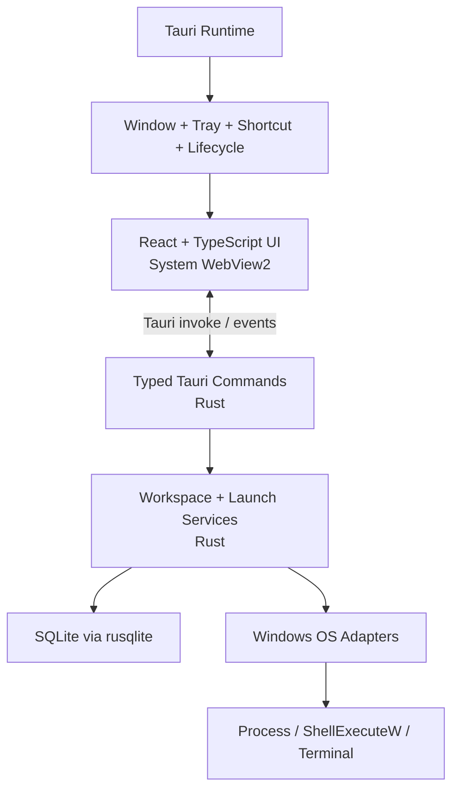

# DeskPilot: Product Requirements & Engineering Specification

> **Document type:** Agent-ready Product Requirements Document (PRD) + Technical Design Specification  
> **Product:** DeskPilot  
> **Version:** 1.1 (Lightweight Windows edition)  
> **Status:** Ready for lightweight implementation  
> **Target release:** Windows desktop MVP  
> **Build target:** 3–5 focused development days  
> **Primary audience:** A coding agent implementing the complete first release

---

## 0. Instructions to the coding agent

Build DeskPilot as a working Windows desktop application, not as a static UI prototype.

### Execution rules

1. Read this document completely before creating files.
2. Implement the product in the milestone order in Section 16. Keep the app runnable at the end of each milestone.
3. Do not replace real functionality with mock data, fake buttons, or hardcoded dashboard metrics. Seed data is allowed only for the first-run experience and must be editable/deletable.
4. Use Tauri 2 with a Rust backend and a React + TypeScript frontend. Rust owns all privileged OS operations and persistent storage.
5. Use a single local SQLite database through `rusqlite`. Do not add a cloud backend, account system, analytics service, or AI API.
6. Use typed Tauri commands with a narrow allowlist. Never expose unrestricted shell execution, arbitrary filesystem access, or generic process spawning to the frontend.
7. Validate all command inputs in Rust. Use TypeScript types and Zod for immediate frontend form feedback; Rust validation is authoritative. Treat frontend input and imported data as untrusted.
8. Launch processes only from Rust using `std::process::Command`, explicit executables, and argument arrays. Never invoke a command interpreter for normal application launches.
9. Do not execute terminal commands from workspace data in MVP. Terminal items only open a terminal at a selected working directory.
10. Do not add features outside the MVP unless every P0 requirement is complete and tested.
11. When a requirement is technically constrained by Windows or Tauri/WebView2, implement the documented fallback and explain the limitation in the UI or README. Do not pretend an operation succeeded.
12. Keep implementation decisions consistent with this document. If a small detail is unspecified, choose the simplest secure behavior and document it.

### Definition of done

The MVP is done only when a Windows user can install the application, create and edit workspaces, add applications/folders/URLs/terminal locations, launch a workspace, use the global shortcut while DeskPilot is running, manage notes and checklists, view launch history, and retain data after restarting. Optional tray-only mode must be off by default and must not keep a hidden WebView alive.

---

# 1. Product overview

## 1.1 Product statement

**DeskPilot is a local-first Windows workspace launcher that restores a person's working context with one action.**

A workspace is a saved collection of applications, folders, website links, terminal locations, notes, and checklist items. A user can create separate workspaces such as Development, Study, Job Search, Personal, or Meetings and open the relevant setup without repeatedly finding and launching each resource.

DeskPilot is a lightweight personal control center. It is not a project-management platform, general-purpose automation engine, or replacement for Windows Start/Search.

## 1.2 Core problem

People repeatedly perform the same setup routine when switching activities:

- Find and open the same applications.
- Navigate to the same project folders.
- Open the same documentation and reference websites.
- Open terminals in the correct directories.
- Remember what they were doing and what needs to be done next.

This setup is repetitive, fragmented, and easy to interrupt. DeskPilot packages that context into reusable workspaces.

## 1.3 Product promise

> Pick a workspace. Launch the tools and context needed for that activity. Get back to work.

## 1.4 Target users

### Primary persona: Individual Windows power user

- Uses several applications and browser tabs for different activities.
- Repeats a similar setup multiple times per week.
- Wants a faster way to switch between work modes.
- Prefers local storage and does not need team collaboration.

### Secondary persona: Student or early-career developer

- Has separate Coding, Study, and Job Search routines.
- Uses VS Code, terminals, browser tabs, PDF readers, folders, and notes.
- Wants a low-friction desktop utility rather than another web app.

## 1.5 Product principles

1. **Fast:** A saved workspace should be launchable in one or two actions.
2. **Local-first:** Workspace data remains on the user's PC.
3. **Windows-native in behavior:** Respect familiar Windows controls, keyboard conventions, file pickers, system tray behavior, and typography.
4. **Understandable:** The user should know exactly what will open before launching.
5. **Safe by default:** No automatic command execution, no hidden scripts, and no silent destructive actions.
6. **Reliable over clever:** Continue launching valid items when one item fails and report the failure clearly.
7. **Useful without an account:** No sign-in or cloud dependency.

---

# 2. Goals, non-goals, and success criteria

## 2.1 MVP goals

- Create, edit, duplicate, reorder, favorite, and delete workspaces.
- Add four launch item types: Application, Folder, URL, and Terminal.
- Launch every enabled item in a workspace using a single action.
- Provide a global keyboard shortcut to open a quick workspace switcher.
- Attach a note and checklist to each workspace.
- Store all information locally in SQLite.
- Show recent launch history and item-level launch results.
- Optional Windows system tray behavior (P1); the app must work without a tray icon.
- Package the app as a Windows installer.

## 2.2 Non-goals for MVP

Do not implement these in the first release:

- Cloud sync, accounts, authentication, or multi-user collaboration.
- AI recommendations, AI categorization, or AI chat.
- Automatic capture of the user's current desktop state.
- Reliable restoration of exact window positions, sizes, monitor assignments, or browser sessions.
- Browser extension or browser-specific profile synchronization.
- Arbitrary PowerShell, CMD, Bash, or shell command execution.
- Scheduled or conditional automation.
- Plugin marketplace.
- Mobile application.
- macOS or Linux release packaging.
- Advanced process supervision, process termination, or rollback of launched applications.
- Automatic application discovery from every installed program. Users select an executable or shortcut manually in MVP.

## 2.3 Success criteria

The release should satisfy all of the following:

- A new user can create their first workspace without reading documentation.
- A workspace with at least one item of each supported type can be launched.
- A missing executable or folder produces a visible failure and does not prevent other valid items from launching.
- The global shortcut opens the quick switcher when DeskPilot is running and its main window is hidden or minimized. A fully quit app has no registered hotkey. The shortcut is unavailable after a full quit.
- Notes, checklist state, settings, workspaces, and launch history survive app restart.
- The webview frontend cannot invoke arbitrary filesystem or process operations.
- The installer works on a clean supported Windows machine.

---

# 3. Supported platform and technical constraints

## 3.1 Platform

- Primary target: Windows 11 x64.
- Compatibility target: Windows 10 x64 (22H2) when the installed Microsoft Edge WebView2 Runtime meets the minimum required version.
- Display scaling: Must remain usable at 100%, 125%, 150%, and 200% DPI scaling.
- Window resizing: Supported. Layout must adapt to the minimum supported size.
- Offline use: Core functionality must work without internet access. Opening a URL naturally requires connectivity.
- Runtime: Use the system-installed Microsoft Edge WebView2 Runtime. Do not bundle a fixed WebView2 runtime with DeskPilot.

## 3.2 Technical stack

The primary engineering goal is low idle memory and low background overhead. Do not use Electron, a bundled Chromium runtime, a local HTTP server, or a cloud service.

| Layer | Technology | Responsibility |
|---|---|---|
| Desktop runtime | Tauri 2 | Native Windows window, tray, lifecycle, commands, OS integration |
| Native backend | Rust | Workspace logic, SQLite access, launch orchestration, Windows APIs |
| Web frontend | React + TypeScript + Vite | Lightweight settings, workspace UI, quick switcher |
| Rendering runtime | System WebView2 | Uses the Windows Edge WebView2 Runtime rather than bundling Chromium |
| UI styling | CSS Modules + small custom Fluent-inspired token set | Windows 11-friendly visuals without a large component framework |
| Icons | Small SVG icon set (Lucide or Fluent System Icons, tree-shaken) | Consistent interface icons |
| Local database | SQLite via `rusqlite` | Persistent local data; use a single connection behind a Rust mutex |
| Frontend validation | Zod (small dependency) | Immediate form feedback only; never a security boundary |
| Backend validation | Rust types + `serde` + explicit validators | Authoritative validation for every Tauri command |
| Windows integration | `windows` crate | Narrow `ShellExecuteW` wrappers for folders, shortcuts, and URLs |
| URL parsing | `url` crate | Validate and normalize HTTP(S) URLs |
| IDs | `uuid` crate | Stable record identifiers |
| Native dialogs | Tauri dialog plugin | Native executable and folder pickers |
| Global shortcut | Tauri global-shortcut plugin | Register/unregister the quick-switcher shortcut |
| Single instance | Tauri single-instance plugin | Avoid duplicate app instances and database connections |
| Tests | Rust unit/integration tests + Vitest + React Testing Library | Backend logic and frontend behavior |
| Packaging | Tauri bundler, NSIS | Windows installer |

Use current mutually compatible stable package releases at implementation time. Pin dependencies in `Cargo.lock` and the frontend lockfile. Prefer built-in Tauri features over adding more plugins. Do not install the Tauri shell plugin for general command execution.

Windows installer policy: use Tauri `webviewInstallMode: { type: "downloadBootstrapper", silent: true }`. This keeps the app installer small and relies on the shared Microsoft WebView2 Runtime. Do not use `offlineInstaller` or `fixedRuntime` because those add a large runtime payload.

## 3.3 Architectural constraints

- Tauri 2 is mandatory for the MVP. Do not silently switch back to Electron.
- Rust owns all privileged operations: database access, path validation, process launching, URL/folder opening, shortcut registration, and tray lifecycle.
- The React frontend runs only bundled local assets inside the system WebView2 runtime. Never load remote application code.
- Expose only named Tauri commands. Do not create a generic `run_command`, `execute_shell`, `read_any_file`, or unrestricted process API.
- Configure Tauri capabilities using least privilege. Only the main window receives the permissions it needs. Do not grant broad filesystem or shell permissions.
- Do not add a local HTTP server. Frontend-to-backend communication uses Tauri `invoke` commands and Tauri events.
- Apply a restrictive Content Security Policy. No remote scripts, remote fonts, remote CSS, or analytics.
- Do not add a large component library, runtime CSS-in-JS library, heavy state-management library, or unnecessary animation package.
- Use lazy imports for non-critical screens. Keep the initial dashboard bundle small.
- No background polling, periodic database refresh, file-system watcher, process watcher, or telemetry loop.
- Use event-driven updates for launch progress. Idle state should have no recurring timers except the minimal debounce needed for note autosave.
- Never use `eval`, `new Function`, or dynamic execution of workspace values.
- Do not bundle a private WebView2 runtime. The installer should use Tauri's small WebView2 bootstrapper mode so Windows can install/update the shared runtime if needed.

Official references:
- Tauri security capabilities: https://v2.tauri.app/security/capabilities/
- Tauri Windows installer and WebView2 modes: https://v2.tauri.app/distribute/windows-installer/
- Tauri global shortcuts: https://v2.tauri.app/plugin/global-shortcut/

---

# 4. Product terminology and domain model

| Term | Meaning |
|---|---|
| Workspace | A named collection of launch items, a note, and checklist tasks |
| Launch item | One resource to open when a workspace is launched |
| Application item | An executable or Windows shortcut to open |
| Folder item | A directory to open in Windows File Explorer |
| URL item | A web address to open using the default browser |
| Terminal item | A terminal window opened at a selected working directory; no command is executed |
| Launch run | One attempt to launch all enabled items in a workspace |
| Quick switcher | Searchable compact interface opened using a global shortcut |
| Workspace trust | Not required for MVP because terminal items only open folders and do not execute commands |

---

# 5. Functional requirements

Priority definitions:
- **P0:** Required for MVP release.
- **P1:** Valuable but can be deferred if time is constrained.
- **P2:** Post-MVP.

## 5.1 Workspace management

### FR-W01: Create workspace (P0)

The user can create a workspace with:
- Name (required, 1–40 characters).
- Optional description (maximum 160 characters).
- Icon selected from a fixed set of Fluent icons.
- Accent color selected from a limited accessible palette.
- Favorite toggle.

Validation:
- Trim leading and trailing whitespace.
- Reject an empty name.
- Workspace names do not need to be unique, but duplicate names should show a non-blocking warning.
- Generate a UUID for each workspace.

### FR-W02: Edit workspace (P0)

The user can edit name, description, icon, color, and favorite state without changing the workspace ID or launch item IDs.

### FR-W03: Duplicate workspace (P1)

Duplicate a workspace, including launch items, note content, and checklist tasks. Generate new IDs for the duplicate and its child records. Reset checklist completion to false by default. Ask whether to copy completed states only if this can be implemented without delaying MVP.

### FR-W04: Delete workspace (P0)

- Require a confirmation dialog.
- Clearly state that deleting a workspace permanently removes its launch items, note, and checklist tasks from DeskPilot. Launch history is retained with workspace-name and item-name snapshots, but becomes unlinked from the deleted workspace.
- Do not delete any application executable, folder, file, or browser data referenced by the workspace.
- Use a database transaction.

### FR-W05: Reorder workspaces (P1)

Allow drag-and-drop ordering. Persist a numeric `sort_order`. If drag-and-drop is not completed, provide Move Up and Move Down actions.

### FR-W06: Favorite workspace (P0)

Favorite workspaces appear in a dedicated section and are prioritized in the quick switcher.

### FR-W07: Workspace search (P0)

Search workspace name and description. Search is case-insensitive and updates as the user types.

## 5.2 Launch item management

All launch items must have:
- ID (UUID).
- Workspace ID.
- Type.
- Display name.
- Enabled state.
- Sort order.
- Type-specific configuration.
- Creation and update timestamps.

### FR-I01: Application item (P0)

Fields:
- Display name.
- Executable path (`.exe`) or Windows shortcut (`.lnk`).
- Optional argument list. Each argument is stored as a separate string.
- Optional working directory.

Behavior:
- Use a Windows file picker to select the executable or shortcut.
- Validate the selected path exists when saving.
- On launch, open the configured application.
- For `.exe`, use Rust `std::process::Command::new(executablePath).args(args)` with `current_dir` when configured. Do not invoke a shell. Detach/close inherited handles as appropriate for Windows and return after process creation succeeds.
- For `.lnk`, use the Windows ShellExecuteW `open` operation from Rust (via the `windows` crate) so Windows resolves the shortcut. Do not parse shortcut internals in the frontend.
- Do not wait for the application to exit.
- If launch fails, record a useful error and continue with other items.
- Provide a Locate button when the stored path no longer exists.

Do not store credentials or secret tokens in application arguments. Show a warning if the user enters argument strings that appear to contain secrets, but do not attempt to infer every possible secret pattern.

### FR-I02: Folder item (P0)

Fields:
- Display name.
- Absolute folder path.

Behavior:
- Use a native directory picker.
- Validate path exists and is a directory when saving.
- Open with the Windows default file manager using a native OS integration.
- Record an item-level success or failure.
- Provide a Locate Folder action if the path becomes invalid.

### FR-I03: URL item (P0)

Fields:
- Display name.
- URL.

Behavior:
- Accept only `http:` and `https:` schemes in MVP.
- Normalize a URL only when safe to do so; do not silently change its host or path.
- Open the URL in the user's default browser through the Windows ShellExecuteW `open` operation from Rust, after strict `http`/`https` validation.
- Validate again at launch time.
- Never open `javascript:`, `file:`, `data:`, custom, or unknown schemes.
- A workspace may contain multiple URL items. Launch them in configured order after local application/folder/terminal items have been initiated.
- Explain in the UI that tab-versus-window behavior is determined by the user's default browser. Do not promise exact browser window/session restoration.

### FR-I04: Terminal item (P0)

Fields:
- Display name.
- Working directory.
- Terminal preference: Windows Terminal or PowerShell. Default: Windows Terminal, with PowerShell fallback.

Behavior:
- Open a terminal in the selected working directory.
- Do not execute a command, script, or shell profile argument defined by the workspace.
- Prefer Windows Terminal (`wt.exe`) when selected and available.
- If Windows Terminal cannot be started, offer PowerShell as a fallback; the fallback must open at the chosen directory only.
- If the directory does not exist, mark the item failed and continue.
- If fallback is used, show a warning in the run result.

PowerShell fallback must pass a safely constructed `Set-Location -LiteralPath` path. Escape single quotes in paths correctly. Do not concatenate arbitrary user-entered commands into this string.

### FR-I05: Enable/disable item (P0)

Disabled items remain visible in the workspace editor but are skipped during launch. Skipped items must be reported as `skipped`, not `failed`.

### FR-I06: Reorder launch items (P0)

Allow drag-and-drop ordering inside a workspace. If drag-and-drop creates excessive implementation cost, provide Move Up / Move Down controls. Persist ordering.

### FR-I07: Remove launch item (P0)

Remove only the item's database record. Never remove or modify the referenced external resource.

### FR-I08: Missing resource detection (P0)

When a workspace is opened or launched, validate configured local paths. If a path is missing:
- Mark it as needing attention in the UI.
- Do not automatically delete or rewrite the path.
- Offer Locate/Replace and Remove actions.
- During launch, mark it as failed and continue with other items.

## 5.3 Workspace notes and checklist

### FR-N01: Workspace note (P0)

- One note per workspace.
- Plain-text or Markdown-compatible text editor; MVP does not need rich text rendering.
- Auto-save after a 500–800 ms debounce and on blur.
- Show a subtle Saved / Saving / Save failed state.
- Persist note text locally.
- Do not execute embedded links, scripts, or HTML.

### FR-N02: Checklist tasks (P0)

Each task has:
- UUID.
- Workspace ID.
- Title (required, 1–120 characters).
- Completed boolean.
- Sort order.
- Created/updated timestamps.

Actions:
- Add task.
- Toggle completion.
- Edit title.
- Delete task.
- Reorder tasks.

Display completed tasks below active tasks by default, but retain user ordering within each group. Completion state persists immediately.

### FR-N03: Checklist progress (P0)

Display `completed / total` and a progress indicator. Empty checklists show an Add task prompt, not 0% progress UI.

## 5.4 Workspace launch engine

### FR-L01: Launch workspace (P0)

A user can launch a workspace from:
- Workspace card.
- Workspace detail page.
- Quick switcher.
- System tray menu for recent/favorite workspaces, only when optional tray mode is enabled.

Launch behavior:
1. Create a launch run record with status `running`.
2. Read the workspace and enabled launch items from the database.
3. Validate all item configs and local paths.
4. Sort by `sort_order`, while respecting the launch phase rules below.
5. Launch non-URL items first, sequentially in saved order.
6. Launch URL items last, in saved order, with a short configurable delay between URLs (default 250 ms) to reduce bursts. The delay is not a guarantee of browser tab grouping.
7. Continue after an individual item failure.
8. Persist each item's outcome as soon as it is known.
9. Finalize the launch run with `completed`, `completed_with_errors`, or `failed`.
10. Update workspace `last_launched_at` only if the launch run was started.
11. Show a concise result summary and allow the user to inspect details.

A workspace with zero enabled items must not silently create a successful run. Show an Empty workspace message and offer Edit workspace.

### FR-L02: Item result states (P0)

Allowed states:
- `pending`: not yet attempted.
- `running`: launch attempt in progress.
- `success`: OS launch request completed successfully.
- `warning`: launch succeeded using a fallback or with a non-fatal caveat.
- `failed`: launch request failed.
- `skipped`: item disabled or explicitly skipped.
- `cancelled`: item was not started because the user cancelled queued work.

Important: `success` means the OS accepted/opened the launch request. It does not mean the external application has fully loaded or is healthy.

### FR-L03: Failure handling (P0)

- Use a typed result object for every item.
- Capture a user-readable message and an internal error code.
- Avoid showing raw stack traces in normal UI.
- Continue launching remaining items after a failure.
- Never retry a failed launch automatically in MVP.
- Offer Retry failed items from the result view (P1 if time-constrained).

### FR-L04: Cancel pending launch work (P1)

Allow cancellation of items that have not started. Do not claim to terminate already-started external applications. If omitted, the launch UI must not show a fake Cancel button.

### FR-L05: Launch history (P0)

Store:
- Launch run ID.
- Workspace ID and workspace name snapshot.
- Start/end timestamps.
- Total, success, warning, failed, skipped counts.
- Per-item name/type snapshots and result messages.

Display the last 20 runs in the Activity view. Keep history for the last 90 days or a maximum of 500 runs, whichever is lower. Prune older records on application startup in a transaction.

### FR-L06: Launch progress (P0)

Display progress such as `Launching 3 of 7`. Update the UI as each item completes. Do not block the WebView UI thread with synchronous work. The Rust launch task must run asynchronously and emit progress events.

## 5.5 Quick switcher and global shortcut

### FR-Q01: Global shortcut (P0)

- Default: `Ctrl + Alt + Space`.
- User can change the shortcut in Settings.
- Register the shortcut during Tauri application setup, after plugins are initialized.
- If the shortcut is already registered by another application, show a non-blocking warning and keep the in-app menu option available.
- Unregister the previous shortcut before registering a replacement.
- Unregister on application quit.
- Validate accelerator strings before attempting registration.

Tauri global shortcut reference: https://v2.tauri.app/plugin/global-shortcut/

### FR-Q02: Quick switcher behavior (P0)

The shortcut is registered only while the DeskPilot process is active. It does not launch DeskPilot after a full quit. When pressed:
1. Recreate the WebView window if the user enabled tray-only mode and the WebView was destroyed; otherwise restore/show the main window if hidden or minimized.
2. Focus the application window.
3. Open a modal quick switcher overlay.
4. Focus the search input automatically.
5. Show favorites first, then recently launched workspaces.
6. Filter by workspace name and description as the user types.
7. Arrow Up/Down changes selection.
8. Enter launches the selected workspace.
9. Escape closes the overlay.
10. Clicking outside closes the overlay unless a launch is in progress.

If a launch is in progress, disable duplicate launch of the same workspace until its current run completes. Other workspaces may be launched separately; each run is tracked independently. Do not disable the entire app during a launch.

### FR-Q03: Keyboard navigation (P0)

- `Ctrl + K`: open quick switcher when app window is focused.
- `Escape`: close current modal/popover or quick switcher.
- `Enter`: confirm selected workspace or primary dialog action.
- Arrow keys: navigate selectable lists.
- `Ctrl + N`: create workspace when not editing text.

Do not capture common typing shortcuts globally outside the application window.

## 5.6 System tray and app lifecycle

### FR-T01: Tray icon (P1)

Create the tray icon only when the user has enabled Keep running in tray. Tray mode is optional and is not required for a normal app session.

Tray menu:
- Open DeskPilot.
- Launch recent workspace (up to 5).
- Open Quick Switcher.
- Quit DeskPilot.

### FR-T02: Keep running in tray setting (P1)

- Default: disabled. Closing the window exits DeskPilot completely and releases its memory.
- The user may explicitly enable “Keep running in tray” in Settings.
- When enabled, closing the main window must destroy/close the WebView window while keeping only the lightweight Rust host and native tray icon alive. Close idle database handles while the WebView is destroyed; reopen storage only when a tray action needs it. Do not merely hide a fully loaded React/WebView window if this can be avoided.
- Clicking Open DeskPilot, invoking the global shortcut, or selecting a workspace from the tray recreates the WebView window on demand.
- Show a one-time message explaining that background mode keeps a small DeskPilot process active.
- Quit must remain available in the tray menu.
- If the implementation cannot reliably destroy and recreate the WebView window, defer tray-only mode and retain the default close-to-quit behavior. Never claim the app is lightweight while leaving a hidden webview running without measuring it.

### FR-T03: Single instance (P0)

Register the Tauri single-instance plugin before other plugins. If a second process starts, focus or recreate the existing window and open/focus the quick switcher if a supported argument requests it. Do not create duplicate tray icons or DB connections.

### FR-T04: Start minimized (P1)

Optional setting to start minimized to the tray. Default off. This setting is available only when Keep running in tray is enabled. Do not make first-run setup invisible.

## 5.7 Settings

### FR-S01: Appearance (P0)

- System (default).
- Light.
- Dark.

Persist the selection and apply it immediately.

### FR-S02: Global shortcut (P0)

Show current accelerator, allow capture of a new accelerator, validate it, and report if registration fails.

### FR-S03: Close behavior (P1)

Show “Keep running in tray” as an optional P1 toggle (off by default). Explain that the global shortcut works only while DeskPilot is running.

### FR-S04: Launch behavior (P0)

- Launch local items sequentially in saved order. Do not create a persistent worker pool.
- Delay between URL opens: default 250 ms; allowed range 0–1500 ms.
- Show an in-app launch-complete toast: default enabled. Native Windows toast notifications are out of MVP.

### FR-S05: Data location (P0)

Show the local database location and provide an Open Data Folder button. Do not allow the database path to be changed in MVP.

### FR-S06: Reset data (P1)

Provide a destructive Reset Local Data action with confirmation and an optional export reminder. Must close DB handles before deleting or replacing the DB.

---

# 6. UX and Windows visual design specification

## 6.1 Design direction

The UI should feel like a polished Windows 11 utility: calm, structured, compact, familiar, and keyboard-friendly. Use CSS Modules with Fluent-inspired design tokens components and tokens as the foundation. Avoid a generic web-admin dashboard aesthetic.

### Visual principles

- Use the Windows system font stack, prioritizing `Segoe UI Variable`, then `Segoe UI`, then system sans-serif.
- Respect system light/dark preference when Theme = System.
- Prefer standard Windows title bar and native window controls. Do not build a custom draggable title bar for MVP.
- Use Fluent surfaces, buttons, dialogs, tooltips, menus, fields, and icons.
- Use subtle elevation and borders. Avoid strong gradients, glassmorphism, neon glows, oversized cards, and decorative charts.
- Use a restrained accent blue. Use status colors only for success, warning, and error.
- Keep interactive targets comfortably sized for mouse and keyboard.
- Every icon-only button must have a tooltip and accessible name.
- Use clear focus rings. Never remove keyboard focus indicators.

## 6.2 Design tokens

Use a small custom token set inspired by Windows 11 Fluent design. Do not install Fluent UI React for the MVP.

| Token | Guidance |
|---|---|
| Font | Segoe UI Variable / Segoe UI |
| Base font size | 14 px |
| Secondary text | 12–13 px |
| Page heading | 24–28 px, semibold |
| Section heading | 16–18 px, semibold |
| Spacing | 4, 8, 12, 16, 24, 32 px scale |
| Main sidebar | 224 px fixed at desktop widths |
| Main content padding | 24 px |
| Standard control height | 32–36 px |
| Card radius | 8–12 px |
| Dialog radius | Use Fluent defaults |
| Border | Subtle neutral border from Fluent tokens |
| Motion | 120–180 ms simple transitions; respect reduced motion |

Do not hardcode text colors that break contrast in dark mode. Use Fluent semantic color tokens.

## 6.3 Main window dimensions

- Default: 1180 × 760 px.
- Minimum: 960 × 640 px.
- Resizable: yes.
- Remember last size and position when possible.
- On first launch, center on the active display.
- Use standard Windows title bar and frame.
- Ensure content remains usable when the app is resized to minimum dimensions.

## 6.4 Main window layout

### Left navigation rail

Width: approximately 224 px.

Contents:
- DeskPilot app mark and name.
- Overview.
- Workspaces.
- Activity.
- Settings at bottom.
- Small local-only indicator near the bottom, with tooltip: “Your workspace data stays on this PC.”

### Main content region

- Page title and short description.
- Primary action aligned to the right when appropriate.
- Content uses a grid/list with consistent spacing.
- Avoid unnecessary nested cards.

### Status and notifications

Use Fluent toast/notification patterns for:
- Workspace saved.
- Launch completed.
- Launch completed with errors.
- Shortcut registration failed.
- Data save failed.

Errors that require user action must remain visible in the page, not only in a transient toast.

## 6.5 Required screens

### Screen A: First-run onboarding

Purpose: Help a new user create their first workspace quickly.

Content:
- Welcome heading: “Your work, ready when you are.”
- One-sentence explanation of workspaces.
- Primary CTA: “Create your first workspace”.
- Secondary action: “Explore sample workspaces” (optional; seed data only with consent).
- Explain that data is stored locally.

Do not force account creation or a tutorial carousel.

### Screen B: Overview

Purpose: Show the user's workspaces and provide immediate launch actions.

Layout:
- Heading: “Good to have you back” or simply “Overview”. Avoid time-based greeting logic in MVP.
- Primary CTA: “New workspace”.
- Favorites section.
- All workspaces section.
- Recent activity section with last 3 runs.

Workspace card contents:
- Icon and workspace name.
- Short description, if present.
- Item count.
- Last launched label, if available.
- Favorite indicator.
- Primary Launch button.
- Overflow menu: Edit, Duplicate (P1), Delete.

Cards must show a clear focus state and work with keyboard navigation.

### Screen C: Workspaces list

Purpose: Browse, search, and manage every workspace.

Components:
- Search box.
- Sort selector: Custom order, Recently launched, Name.
- Favorite filter toggle.
- Workspace grid or list. Prefer grid at wide widths and list at narrow widths.
- Empty state with Create workspace CTA.

### Screen D: Workspace detail/editor

Purpose: Configure a workspace and manage its resources.

Header:
- Workspace icon, name, description.
- Launch button as the primary action.
- Overflow menu for Edit details and Delete.

Content sections or tabs:
1. **Launch items**: ordered list of launch resources.
2. **Notes**: autosaving plain-text/Markdown source.
3. **Checklist**: tasks and progress.

Launch item row:
- Type icon.
- Display name.
- Secondary line showing application path, folder, URL host, or terminal directory.
- Enabled toggle.
- Drag handle or Move Up/Down controls.
- Edit and Remove actions.
- Warning state when a local path is missing.

Add item action opens an add-item menu: Application, Folder, Website, Terminal.

Launch item form must use type-specific fields. Use native file/folder pickers through the typed Tauri command API, not raw path entry as the primary flow. Manual path entry may be available as an advanced option.

### Screen E: Launch progress/result

Could be a modal or a dedicated run details panel.

While launching:
- Workspace name.
- Progress: `Launching x of y`.
- Current item name and type.
- Completed, failed, and pending counts.
- Do not freeze UI.

After launch:
- Summary: `5 opened · 1 needs attention`.
- Each item with status, elapsed time, and message.
- CTA: “View details” or “Done”.
- For failed local paths, provide Locate action.

### Screen F: Activity

- Reverse chronological launch history.
- Workspace name snapshot.
- Date/time.
- Outcome summary.
- Duration.
- Selecting a row opens run details.
- Empty state explains that launch history appears after the first workspace launch.

### Screen G: Settings

Sections:
- Appearance: System / Light / Dark.
- Quick switcher shortcut.
- Behavior: Keep running in tray (P1, off by default).
- Launch: URL delay and in-app completion toast (native Windows notifications are not part of MVP).
- Local data: database path and Open Data Folder.
- About: app version and links to README/repository if configured.

### Screen H: Quick switcher

Open from global shortcut or app shortcut.

Visual treatment:
- Compact centered modal over the main window.
- Width approximately 560 px, maximum height 440 px.
- Search input at top, automatically focused.
- Results grouped into Favorites and Recent when query is empty.
- Each result shows icon, name, description or item count, and optional last-launched time.
- Keyboard-first: Arrow Up/Down, Enter, Escape.
- On selection, close the overlay and begin workspace launch.

### Screen I: System tray

Tray menu entries (visible only when Keep running in tray is enabled):
- Open DeskPilot.
- Quick Switcher.
- Recent workspaces submenu (up to five).
- Separator.
- Quit DeskPilot.

Use a recognizable tray icon with light/dark variants if required by Windows. Keep the context menu short.

## 6.6 Responsive behavior

DeskPilot is a desktop app, not a mobile app. Still support a smaller window:
- At widths below 1080 px, reduce content padding and switch workspace cards from three columns to two.
- At widths below 960 px, use one column for workspace cards and collapse sidebar labels if needed. Do not allow the main window below its defined minimum size.
- Forms must remain scrollable within the main content region.

## 6.7 Accessibility

- All functionality is usable without a mouse.
- Use semantic labels and accessible names.
- Maintain visible keyboard focus.
- Do not rely on color alone for status.
- Respect Windows high-contrast settings using CSS `forced-colors` support and semantic focus indicators.
- Support system display scaling.

---

# 7. Core user flows and complete logic

## 7.1 First launch

1. Register the Tauri single-instance plugin first so only one process remains active.
2. Resolve the app-local data directory and initialize SQLite.
3. Run database migrations.
4. Load persisted settings or create defaults.
5. Register the global shortcut while the DeskPilot process is running and unregister it on full quit.
6. Create the tray icon only when the optional Keep running in tray setting is enabled.
7. Create the main WebView window.
8. If there are no workspaces, show onboarding.
9. User creates a workspace.
10. User adds launch items and optionally a note/checklist.
11. User launches the workspace.

Error handling:
- If database initialization fails, show a blocking recoverable error window with the path and log location. Do not continue with an in-memory fake database.
- If shortcut registration fails, the app remains usable and reports the issue in Settings.
- If tray creation fails, the app remains usable; disable Keep running in tray and quit fully when the window closes.

## 7.2 Create workspace flow

1. User selects New Workspace.
2. Open a Fluent dialog or dedicated create form.
3. User enters name, optional description, icon, and color.
4. Validate fields on blur and submit.
5. Rust Tauri command validates the payload using Rust types and explicit validation rules.
6. Insert workspace in a database transaction.
7. Return the created workspace DTO.
8. Navigate to workspace detail page.
9. Show a saved toast only after persistence succeeds.

## 7.3 Add application flow

1. User selects Add Item > Application.
2. Invoke a Rust command that opens a native file dialog filtered for `.exe` and `.lnk`.
3. User chooses a file.
4. Rust Tauri command validates the selected path and extension.
5. UI asks for optional display name, arguments, and working directory.
6. Arguments are entered as a list of individual fields, not a single shell string.
7. User saves.
8. Rust Tauri command revalidates and inserts the item.
9. Workspace detail list refreshes.

If the path is invalid or removed before save, reject with an actionable error.

## 7.4 Add folder flow

1. User selects Add Item > Folder.
2. Invoke a Rust command that opens the native Tauri directory picker.
3. User selects a directory.
4. Rust Tauri command validates it is an existing directory.
5. User may change display name.
6. Save item to database.

## 7.5 Add URL flow

1. User selects Add Item > Website.
2. Enter display name and URL.
3. Validate URL in webview frontend for immediate feedback.
4. Validate URL again in Rust backend.
5. Only HTTP and HTTPS schemes are accepted.
6. Save item.

Show a small helper: “Links open in your default browser. Your browser decides whether they open in a tab or a new window.”

## 7.6 Add terminal flow

1. User selects Add Item > Terminal.
2. Select a working directory with native folder picker.
3. Choose Windows Terminal or PowerShell.
4. Save item.
5. On launch, open the chosen terminal at this directory only.

MVP does not offer a command text field. Do not add one.

## 7.7 Launch workspace orchestration

Implement a dedicated Rust `LaunchService`. The React frontend must request a launch using a workspace ID only; it must never submit an executable command.

### Launch algorithm

```text
launchWorkspace(workspaceId):
  workspace = repository.getWorkspaceWithItems(workspaceId)
  if workspace does not exist:
    return NOT_FOUND

  enabledItems = workspace.items where enabled = true
  if enabledItems.length == 0:
    return EMPTY_WORKSPACE

  run = repository.createLaunchRun(workspace snapshot, totals)
  emit run-started(run)
  start a temporary async launch task; do not create a permanent worker

  orderedItems = stable sort enabledItems by launch phase, then sortOrder
    phase 1: application, folder, terminal
    phase 2: URL

  for each local item, sequentially:
    persist status = running
    emit item-started
    validate item configuration and local resource
    call its Rust OS adapter
    persist result immediately
    emit item-completed

  for each URL item, sequentially in saved order:
    wait configured URL delay before each item after the first
    persist status = running
    emit item-started
    validate URL scheme and length
    call the Windows URL-open adapter
    persist success or failure
    emit item-completed

  calculate final counters
  finalStatus = completed if no failures/warnings
                completed_with_errors if some items fail but at least one opens
                failed if no item is successfully opened
  persist run completion
  update workspace.lastLaunchedAt
  emit run-completed
```

### Launch behavior details

- Launch items sequentially in the MVP. Process creation and ShellExecute requests should return quickly; parallel orchestration is unnecessary for the first release and increases complexity.
- URL items are processed after local items and sequentially in their saved relative order.
- The URL delay is configurable from 0 to 1500 ms, default 250 ms.
- Disabled items are excluded from the queue. They may appear as skipped in the UI summary if that improves clarity.
- A per-item failure must not reject the entire launch operation.
- Catch and normalize every OS integration error.
- Progress is based on completed attempts divided by total enabled items.
- Do not wait for external apps to finish loading or exit.
- Do not kill applications on cancellation or failure.
- If a workspace is deleted while a launch run is active, the run continues using its in-memory snapshot and preserves run history. Deletion removes future configuration but does not terminate already-started items.
- Use a transaction only for creating/finalizing related DB records, not around process launches.
- The launch task exists only while a launch is running. Do not keep an idle queue, timer, or polling loop alive.

### Result object

```ts
export type LaunchItemStatus =
  | 'pending'
  | 'running'
  | 'success'
  | 'warning'
  | 'failed'
  | 'skipped'
  | 'cancelled';

export interface LaunchItemResult {
  itemId: string;
  itemName: string;
  itemType: 'application' | 'folder' | 'url' | 'terminal';
  status: LaunchItemStatus;
  startedAt: string;
  completedAt?: string;
  durationMs?: number;
  message: string;
  errorCode?: string;
}
```

### Item-specific launch behavior

#### Application

- Validate that the configured path exists and has the expected extension.
- For `.exe`, use Rust `std::process::Command::new(executable_path).args(args)` and optional `.current_dir(working_directory)`, then call `.spawn()`.
- Never invoke `cmd.exe`, PowerShell, or another command interpreter for normal application launch.
- Drop the returned `Child` handle after a successful spawn; do not wait for process exit or kill the process when DeskPilot closes.
- For `.lnk`, use Windows `ShellExecuteW` with the `open` verb so Windows resolves the shortcut.
- Pass arguments as an array. Never concatenate application arguments into a shell string.
- If a working directory is set, validate it exists before spawning.

#### Folder

- Validate the path exists and is a directory.
- Use Windows `ShellExecuteW` with the `open` verb to open File Explorer at the selected path. Treat return values greater than 32 as success and normalize error codes for the UI.

#### URL

- Parse the URL using Rust's URL parser.
- Allow only `http` and `https`.
- Reject embedded credentials, malformed URLs, and URLs longer than 2000 characters.
- Use Windows `ShellExecuteW` with the `open` verb after validation to delegate to the user's default browser. Treat return values greater than 32 as success and normalize error codes for the UI.

#### Terminal

- Validate the selected working directory exists.
- For Windows Terminal, build the argument list with separate `.arg(...)` calls, for example `Command::new("wt.exe").arg("-w").arg("new").arg("-d").arg(working_directory)`, to request a separate terminal window. Do not build a shell command string.
- If Windows Terminal cannot be started and fallback is enabled, start PowerShell at the selected directory using a safely quoted `Set-Location -LiteralPath` expression. Escape single quotes in the path by doubling them. The command text must be generated by DeskPilot and must contain no user-supplied command content.
- PowerShell may be selected directly without fallback.
- Do not support `cmd.exe` in MVP.
- Test each supported terminal adapter on a real Windows 11 machine and document any version-specific limitation.
## 7.8 Quick switcher flow

1. Rust global-shortcut plugin receives the registered shortcut event.
2. Rust window manager creates or shows/focuses the main window.
3. Rust emits a typed `quick-switcher:show` Tauri event to the main window after the frontend signals that it is ready. If window creation is still in progress, queue one pending quick-switcher request.
4. Webview frontend opens modal and focuses search field.
5. Webview frontend requests workspace search/list via typed API.
6. User navigates result list with keyboard.
7. User presses Enter.
8. Webview frontend calls `launchWorkspace(workspaceId)`.
9. Modal closes and launch progress is shown.

Do not allow the webview frontend to register or change global shortcuts directly.

## 7.9 Keep running in tray flow

1. User clicks the window close button.
2. Rust lifecycle handler checks the `keepRunningInTray` setting.
3. If enabled and tray is operational, prevent process exit, destroy the WebView window, and keep only the Rust tray host alive.
4. On first occurrence, show a one-time notice that DeskPilot remains active in low-memory tray mode.
5. If disabled or tray creation failed, unregister shortcuts, close SQLite, and quit fully.
6. Tray > Open recreates the WebView window; Tray > Quit unregisters shortcuts, closes SQLite, removes the tray icon, and exits the Rust process.

---

# 8. Application architecture

## 8.1 Architecture overview

Use a single native Rust application process hosting one WebView2 frontend. There is no Node.js runtime, Electron main process, preload process, or local HTTP server.



## 8.2 Runtime responsibilities

### Rust application backend

Owns:
- Tauri application lifecycle and single-instance plugin.
- Main WebView window creation, destruction, restoration, and window settings.
- Native system tray and tray menu.
- Global shortcut registration/unregistration.
- Typed Tauri commands and event emission.
- SQLite database initialization, migrations, and repositories.
- Workspace, item, note, task, settings, and launch services.
- Launch orchestration and progress reporting.
- Native file/folder dialogs through the Tauri dialog plugin.
- OS process launch adapters using `std::process::Command` and narrowly scoped Windows APIs.
- Structured local logging.

### React frontend

Owns:
- Views, forms, local interaction state, dialogs, navigation, and toasts.
- Client-side Zod validation for immediate feedback only.
- Calls typed functions in a small `src/lib/desktop-api.ts` wrapper using Tauri `invoke` and `listen`.
- Displays DTOs returned from Rust.
- Must not import Node built-ins, access local files directly, or construct shell commands.

### Shared contracts

- Define frontend DTOs and command input/output types in TypeScript.
- Define matching Rust structs with `serde` in the backend.
- Keep payload shapes aligned and add contract tests for critical DTOs.
- Rust validation remains authoritative; TypeScript types and Zod are not a security boundary.

## 8.3 Suggested directory structure

```text
deskpilot/
├── src/
│   ├── app/
│   ├── components/
│   ├── features/
│   │   ├── overview/
│   │   ├── workspaces/
│   │   ├── launch/
│   │   ├── quick-switcher/
│   │   ├── activity/
│   │   └── settings/
│   ├── hooks/
│   ├── lib/
│   │   ├── desktop-api.ts
│   │   └── formatters.ts
│   ├── styles/
│   ├── main.tsx
│   └── vite-env.d.ts
├── src-tauri/
│   ├── Cargo.toml
│   ├── tauri.conf.json
│   ├── capabilities/
│   │   └── main.json
│   ├── icons/
│   └── src/
│       ├── main.rs
│       ├── lib.rs
│       ├── commands/
│       │   ├── mod.rs
│       │   ├── workspace.rs
│       │   ├── item.rs
│       │   ├── notes.rs
│       │   ├── tasks.rs
│       │   ├── launch.rs
│       │   └── settings.rs
│       ├── services/
│       │   ├── launch_service.rs
│       │   └── workspace_service.rs
│       ├── adapters/
│       │   ├── application_launcher.rs
│       │   ├── folder_launcher.rs
│       │   ├── url_launcher.rs
│       │   ├── terminal_launcher.rs
│       │   └── windows_paths.rs
│       ├── database/
│       │   ├── connection.rs
│       │   ├── migrate.rs
│       │   ├── schema.sql
│       │   └── repositories/
│       └── logging/
├── tests/
│   ├── frontend/
│   └── fixtures/
├── package.json
├── vite.config.ts
├── tsconfig.json
├── Cargo.lock
└── README.md
```

Keep the project as one Tauri application. Do not create a monorepo unless a concrete build constraint requires it.

## 8.4 Database location

Use Tauri's `app_local_data_dir()` (or the matching app-local data directory resolver in the Tauri version pinned by the project) and create a DeskPilot subdirectory if needed.

Suggested Windows location:

```text
%LOCALAPPDATA%\DeskPilot\deskpilot.sqlite
%LOCALAPPDATA%\DeskPilot\logs\
%LOCALAPPDATA%\DeskPilot\backups\
```

Never store the database in the installation directory. Use SQLite foreign keys, prepared statements, migrations, and one connection protected by a Rust mutex. Enable a short busy timeout and WAL only if concurrent read/write testing shows it is beneficial. Database operations are short and local; do not poll the database from the UI.

## 8.5 SQLite schema

Use migrations and foreign keys. Enable foreign key enforcement on every connection. Use prepared statements for all values.

### `workspaces`

```sql
CREATE TABLE workspaces (
  id TEXT PRIMARY KEY,
  name TEXT NOT NULL,
  description TEXT NOT NULL DEFAULT '',
  icon TEXT NOT NULL DEFAULT 'apps',
  color TEXT NOT NULL DEFAULT 'blue',
  is_favorite INTEGER NOT NULL DEFAULT 0 CHECK (is_favorite IN (0, 1)),
  sort_order INTEGER NOT NULL DEFAULT 0,
  created_at TEXT NOT NULL,
  updated_at TEXT NOT NULL,
  last_launched_at TEXT
);
```

### `launch_items`

```sql
CREATE TABLE launch_items (
  id TEXT PRIMARY KEY,
  workspace_id TEXT NOT NULL,
  type TEXT NOT NULL CHECK (type IN ('application', 'folder', 'url', 'terminal')),
  name TEXT NOT NULL,
  config_json TEXT NOT NULL,
  enabled INTEGER NOT NULL DEFAULT 1 CHECK (enabled IN (0, 1)),
  sort_order INTEGER NOT NULL DEFAULT 0,
  created_at TEXT NOT NULL,
  updated_at TEXT NOT NULL,
  FOREIGN KEY (workspace_id) REFERENCES workspaces(id) ON DELETE CASCADE
);
CREATE INDEX idx_launch_items_workspace ON launch_items(workspace_id, sort_order);
```

`config_json` must be parsed and validated against the schema for its `type` every time it is read for launch. Do not trust stored JSON blindly.

### `workspace_notes`

```sql
CREATE TABLE workspace_notes (
  workspace_id TEXT PRIMARY KEY,
  content TEXT NOT NULL DEFAULT '',
  updated_at TEXT NOT NULL,
  FOREIGN KEY (workspace_id) REFERENCES workspaces(id) ON DELETE CASCADE
);
```

### `workspace_tasks`

```sql
CREATE TABLE workspace_tasks (
  id TEXT PRIMARY KEY,
  workspace_id TEXT NOT NULL,
  title TEXT NOT NULL,
  is_completed INTEGER NOT NULL DEFAULT 0 CHECK (is_completed IN (0, 1)),
  sort_order INTEGER NOT NULL DEFAULT 0,
  created_at TEXT NOT NULL,
  updated_at TEXT NOT NULL,
  FOREIGN KEY (workspace_id) REFERENCES workspaces(id) ON DELETE CASCADE
);
CREATE INDEX idx_workspace_tasks_workspace ON workspace_tasks(workspace_id, sort_order);
```

### `launch_runs`

```sql
CREATE TABLE launch_runs (
  id TEXT PRIMARY KEY,
  workspace_id TEXT,
  workspace_name_snapshot TEXT NOT NULL,
  status TEXT NOT NULL CHECK (status IN ('running', 'completed', 'completed_with_errors', 'failed')),
  started_at TEXT NOT NULL,
  completed_at TEXT,
  total_count INTEGER NOT NULL DEFAULT 0,
  success_count INTEGER NOT NULL DEFAULT 0,
  warning_count INTEGER NOT NULL DEFAULT 0,
  failed_count INTEGER NOT NULL DEFAULT 0,
  skipped_count INTEGER NOT NULL DEFAULT 0,
  FOREIGN KEY (workspace_id) REFERENCES workspaces(id) ON DELETE SET NULL
);
CREATE INDEX idx_launch_runs_started ON launch_runs(started_at DESC);
```

### `launch_run_items`

```sql
CREATE TABLE launch_run_items (
  id TEXT PRIMARY KEY,
  run_id TEXT NOT NULL,
  launch_item_id TEXT,
  item_name_snapshot TEXT NOT NULL,
  item_type TEXT NOT NULL,
  status TEXT NOT NULL CHECK (status IN ('pending', 'running', 'success', 'warning', 'failed', 'skipped', 'cancelled')),
  started_at TEXT,
  completed_at TEXT,
  duration_ms INTEGER,
  message TEXT NOT NULL DEFAULT '',
  error_code TEXT,
  FOREIGN KEY (run_id) REFERENCES launch_runs(id) ON DELETE CASCADE,
  FOREIGN KEY (launch_item_id) REFERENCES launch_items(id) ON DELETE SET NULL
);
CREATE INDEX idx_run_items_run ON launch_run_items(run_id);
```

### `settings`

```sql
CREATE TABLE settings (
  key TEXT PRIMARY KEY,
  value_json TEXT NOT NULL,
  updated_at TEXT NOT NULL
);
```

## 8.6 Data model contracts

Use discriminated unions. Example:

```ts
export type LaunchItemConfig =
  | {
      type: 'application';
      executablePath: string;
      args: string[];
      workingDirectory?: string;
    }
  | {
      type: 'folder';
      path: string;
    }
  | {
      type: 'url';
      url: string;
    }
  | {
      type: 'terminal';
      workingDirectory: string;
      terminal: 'windowsTerminal' | 'powershell';
      allowFallback: boolean;
    };

export interface WorkspaceDTO {
  id: string;
  name: string;
  description: string;
  icon: string;
  color: string;
  isFavorite: boolean;
  sortOrder: number;
  itemCount: number;
  createdAt: string;
  updatedAt: string;
  lastLaunchedAt: string | null;
}

export interface WorkspaceDetailDTO extends WorkspaceDTO {
  items: LaunchItemDTO[];
  note: string;
  tasks: WorkspaceTaskDTO[];
}
```

Use ISO 8601 UTC timestamps in storage. Convert to the user's local timezone only for display.

## 8.7 Tauri command contract

Do not expose a generic command dispatcher. Create a TypeScript wrapper that calls only the named Rust commands registered in `tauri::generate_handler!`. Every Rust command validates its inputs and returns a typed DTO or a normalized error.

Suggested frontend wrapper shape:

```ts
import { invoke } from "@tauri-apps/api/core";
import { listen } from "@tauri-apps/api/event";

export const desktopApi = {
  workspaces: {
    list: (query?: WorkspaceQuery) => invoke<WorkspaceDTO[]>("workspace_list", { query }),
    get: (id: string) => invoke<WorkspaceDetailDTO | null>("workspace_get", { id }),
    create: (input: CreateWorkspaceInput) => invoke<WorkspaceDetailDTO>("workspace_create", { input }),
    update: (id: string, input: UpdateWorkspaceInput) => invoke<WorkspaceDetailDTO>("workspace_update", { id, input }),
    delete: (id: string) => invoke<void>("workspace_delete", { id }),
  },
  items: {
    create: (workspaceId: string, input: CreateLaunchItemInput) => invoke<LaunchItemDTO>("item_create", { workspaceId, input }),
    pickExecutable: () => invoke<string | null>("pick_executable"),
    pickFolder: () => invoke<string | null>("pick_folder"),
  },
  launch: {
    start: (workspaceId: string) => invoke<{ runId: string }>("launch_workspace", { workspaceId }),
    getRun: (runId: string) => invoke<LaunchRunDetailDTO | null>("launch_get_run", { runId }),
  },
};

export async function onLaunchProgress(handler: (event: LaunchProgressEvent) => void) {
  return listen<LaunchProgressEvent>("launch-progress", (event) => handler(event.payload));
}
```

Also implement named commands for notes, tasks, history, settings, system window actions, and opening the app-local data folder. The method names above are preferred; consistency matters more than exact naming.

### Tauri command rules

- Register only the commands the app actually uses in `tauri::generate_handler!`.
- Define a least-privilege capability for the main WebView. Do not grant broad filesystem read/write or shell execution permissions.
- Use the native Tauri dialog plugin for file/folder selection; return only the selected path string to the frontend.
- All path existence, extension, directory, URL scheme, and workspace ownership checks happen again in Rust before persistence or launch.
- Return normalized errors such as `{ code, message }`; do not return raw Rust errors or OS handles.
- Use Tauri events for launch progress. Frontend listeners must be unsubscribed when components unmount.
- Never return a `std::process::Child`, process handle, database connection, or native window handle to the frontend.
- Never permit the frontend to provide a command name, shell string, or unrestricted process command. Only explicit, user-selected resource paths may be persisted as launch configuration.

---

# 9. Security, privacy, and reliability

## 9.1 Local-first privacy

- No account, no cloud sync, and no telemetry in MVP.
- Store workspace data only in the app's local user data folder.
- Do not transmit file paths, workspace names, or notes over the network.
- External network activity occurs only when the user chooses to open a URL.
- Do not store browser passwords, account credentials, or secret tokens.
- Do not capture clipboard contents, screenshots, keystrokes, or application activity.

## 9.2 Tauri security

Mandatory:
- Keep all privileged functionality in Rust commands.
- Configure Tauri 2 capabilities with least privilege and only the permissions required by the main window.
- Do not install or expose the Tauri shell plugin for generic commands. Use Rust's explicit process adapters instead.
- Do not grant broad filesystem read/write permissions to the webview. Use native dialogs and narrow Rust commands.
- Bundle only local frontend assets. Do not load remote webview frontend content.
- Use a restrictive Content Security Policy and no remote script/font/style sources.
- Do not enable arbitrary plugin commands or broad scopes.
- Validate every Tauri command argument in Rust, including values received from the frontend.
- Keep URL opening limited to validated `http` and `https` URLs.
- Do not expose generic file read, file write, process spawn, shell execution, or process kill commands.

References:
- https://v2.tauri.app/security/capabilities/
- https://v2.tauri.app/reference/acl/capability/

## 9.3 Process safety

- Never use `exec()` for workspace application launches.
- Never invoke a shell for normal app launches.
- Use explicit executable paths and argument arrays from Rust.
- Terminal items open a directory only. They do not run user-defined commands.
- Application arguments are passed as an array and are not interpreted by a shell.
- Do not kill, close, or modify external application processes.
- Avoid launching the same item twice accidentally from a double-click. Disable the primary launch action for a short debounce window or provide a clear duplicate-launch behavior.

## 9.4 URL safety

- Allow `http:` and `https:` only.
- Reject credentials embedded in a URL.
- Reject malformed and overlong URLs.
- Do not allow local file URLs.
- Do not automatically follow URL redirects inside DeskPilot; it simply delegates the URL to the default browser.

## 9.5 Data integrity

- Enable SQLite foreign keys.
- Use transactions for workspace deletion, duplication, reordering, and multi-record run creation/finalization.
- Use prepared statements.
- Validate `config_json` before every launch.
- Run schema migrations on startup.
- Do not silently overwrite a corrupt database. Show a recoverable error and preserve a copy for diagnosis.

## 9.6 Logging

- Write rotating local logs.
- Log operation name, error code, and safe diagnostic metadata.
- Do not log note contents, URL query strings, app arguments, environment values, or credentials.
- A local path may be included only when required to diagnose a failure; consider redacting the user's home directory in routine logs.
- Keep normal logs concise and avoid raw stack traces in user-facing surfaces.

---

# 10. Error handling and user-facing messages

Use stable error codes and concise messages.

| Error code | Example user message | Suggested action |
|---|---|---|
| `WORKSPACE_NOT_FOUND` | This workspace no longer exists. | Return to Workspaces |
| `WORKSPACE_EMPTY` | This workspace has no enabled items yet. | Add launch items |
| `PATH_NOT_FOUND` | The saved location could not be found. | Locate the item again |
| `PATH_NOT_DIRECTORY` | The selected location is not a folder. | Choose a folder |
| `APP_LAUNCH_FAILED` | Windows could not start this application. | Check the executable path |
| `FOLDER_OPEN_FAILED` | Windows could not open this folder. | Check folder permissions |
| `URL_INVALID` | Enter a valid HTTP or HTTPS address. | Edit URL |
| `URL_OPEN_FAILED` | The default browser could not open this link. | Check the browser configuration |
| `TERMINAL_NOT_FOUND` | The selected terminal could not be started. | Choose another terminal |
| `SHORTCUT_IN_USE` | This keyboard shortcut is already being used. | Choose another shortcut |
| `DATABASE_ERROR` | DeskPilot could not save your changes. | Retry; check the data folder |
| `COMMAND_VALIDATION_FAILED` | The request could not be processed. | Review the entered values |

Use plain language. Do not show Rust, Win32, or Tauri internal error names in the normal UI.

---

# 11. Empty states, loading states, and edge cases

## 11.1 Empty states

- No workspaces: onboarding and Create Workspace CTA.
- No launch items: explain that this workspace is empty and show Add Item CTA.
- No notes: placeholder text, not seeded fake content.
- No checklist tasks: Add a task.
- No activity: launch a workspace to see history.
- No quick-switcher matches: “No workspaces found”.

## 11.2 Edge cases

- Path has spaces or non-English characters.
- Path contains apostrophes.
- Executable or folder is moved after being saved.
- URL is malformed or uses unsupported protocol.
- User selects the same item more than once.
- Shortcut is already registered by another application.
- User changes shortcut while quick switcher is open.
- User closes main window during a launch.
- App is started twice.
- Database file is locked or inaccessible.
- Workspace is deleted while a launch is active.
- Some items succeed while others fail.
- A terminal executable is unavailable.
- Windows Terminal is installed through an alias but not found on PATH.
- App is installed in a path containing spaces.
- Display scale is changed while app is open.

For every edge case, fail safely and preserve existing data.

---

# 12. Performance, memory, and quality requirements

Performance is a core product requirement, not a later optimization. DeskPilot must behave like a small Windows utility rather than a permanently running browser application. Tauri avoids shipping a separate Chromium runtime, but the React interface still uses WebView2 and consumes memory; this is a reduction in app overhead, not a zero-RAM guarantee.

## 12.1 Runtime and memory rules

- Do not use Electron or bundle Chromium. Use the system WebView2 runtime through Tauri 2.
- The app must not run a local HTTP server.
- Default close behavior is Quit, not Hide. Closing the main window should release all DeskPilot processes and memory.
- “Keep running in tray” is optional and off by default. When enabled, the implementation should retain the Rust tray host but destroy the WebView window while hidden, then recreate it when the user opens DeskPilot or triggers the quick switcher.
- Do not auto-start with Windows in MVP. If later added, it must be opt-in.
- Do not keep a hidden, fully rendered dashboard alive only to preserve a shortcut. Background mode must be measured.
- No background polling, periodic refresh, file watchers, process watchers, or telemetry.
- Load workspace details, activity history, and settings only when those screens are opened.
- Do not pre-fetch every workspace card's full notes, tasks, launch history, or item configuration. Overview queries should return summary DTOs only.
- Keep the number of Rust threads and async tasks minimal. Launch work uses one temporary async task only while a workspace is launching; no permanent worker pool.
- Use one SQLite connection with short transactions. Do not continuously query SQLite while the app is idle.
- Avoid large runtime libraries, charting libraries, state-management packages, and animation frameworks.
- Use event-driven launch progress, not polling.

## 12.2 Measurable targets

Measure on a real Windows 11 x64 machine after a clean install. Report Windows Task Manager process-tree measurements and the exact WebView2 process inclusion method in the README. These are targets to validate, not guaranteed platform-independent constants:

| Metric | Target |
|---|---|
| Cold launch to interactive overview | ≤ 3 seconds on the reference machine after first WebView2 initialization |
| Visible idle memory | Aim for ≤ 120 MB combined private working set across the DeskPilot process and its app-owned WebView2 child processes after 60 seconds idle |
| Tray-only memory | Aim for ≤ 45 MB private working set for the Rust host after the WebView window is destroyed |
| Idle CPU | 0% average over a 60-second idle sample, excluding short OS wakeups |
| Idle recurring work | No app-owned periodic polling or recurring timer |
| Overview responsiveness | 100 workspaces should render without noticeable blocking; use pagination/virtualization only if measurement shows a need |
| Launch feedback | Progress event delivered as each item completes; no UI polling loop |

If memory targets are missed, profile first. Do not hide the measurement or change the target without documenting why. The first optimization order is: remove hidden WebView when in tray mode, remove unnecessary frontend dependencies, lazy-load routes, remove polling/watchers, and reduce duplicate data in memory.

## 12.3 Quality requirements

- No unhandled Rust panics or JavaScript promise rejections in normal flows.
- No duplicate Tauri event listeners after route changes or React remounts.
- No WebView crashes from missing local resources.
- Workspace list should remain responsive with 100 workspaces and 20 launch items each.
- Database queries should be indexed for workspace and launch history lookups.
- Launching a workspace must not block the UI.

---

# 13. Testing strategy and acceptance tests

## 13.1 Unit tests

Test:
- Workspace input validation.
- Launch item discriminated-union validation.
- URL scheme validation and credential rejection.
- Stable launch ordering: local items before URLs; sort order preserved within phase.
- Sequential launch ordering and URL delay.
- Item state transitions.
- Final launch run status calculation.
- Shortcut validation and registration failure handling.
- Path validation using Windows-style paths.
- Safe PowerShell literal-path escaping for apostrophes.
- SQLite repository methods and migrations.

## 13.2 Integration tests

Use mocks for OS adapters, but test real database behavior.

Scenarios:
1. Create workspace and read it back.
2. Add all four launch item types and retrieve the workspace detail.
3. Save note and checklist tasks, restart repository, and verify persistence.
4. Start a launch run with mocked adapters; confirm all item outcomes persist.
5. One item fails; confirm subsequent items still launch.
6. Delete workspace; confirm child records cascade and run history is retained with a null workspace ID or snapshot.
7. Reorder launch items and verify persisted order.
8. Invalid `config_json` is rejected before an OS launch call.

## 13.3 Windows manual acceptance checklist

Run on a real Windows 11 x64 machine:

- [ ] Install from generated NSIS installer.
- [ ] Launch DeskPilot from Start Menu.
- [ ] Create a Development workspace.
- [ ] Add VS Code executable or shortcut.
- [ ] Add a project folder.
- [ ] Add at least two HTTPS links.
- [ ] Add a terminal item for the project folder.
- [ ] Add and complete checklist tasks.
- [ ] Save a workspace note.
- [ ] Launch the workspace and verify each resource opens.
- [ ] Verify URLs open in the default browser.
- [ ] Rename or move an executable and verify the missing-path state.
- [ ] Verify a broken item does not block valid items.
- [ ] Use Ctrl + Alt + Space while another application has focus.
- [ ] Change the global shortcut and verify old shortcut is unregistered.
- [ ] If optional P1 tray-only mode is implemented: enable Keep running in tray, close the window, reopen from tray, and quit from tray. Otherwise verify that closing the main window fully exits DeskPilot.
- [ ] Restart DeskPilot and verify all data persists.
- [ ] Test at 125% and 150% scaling.
- [ ] Test Light, Dark, and System themes.

## 13.4 Release gate

Do not call the MVP complete until all P0 acceptance tests pass. If a P0 item cannot be implemented within the timebox, explicitly label it as deferred in the README and remove corresponding non-functional UI controls.

---

# 14. Installer, packaging, and distribution

- Build a Windows x64 NSIS installer using the Tauri bundler. Use the `downloadBootstrapper` WebView2 installation mode; do not bundle a fixed or offline WebView2 runtime. Document that a machine without WebView2 may need internet access during installation to obtain the runtime; the installed app's core features work offline.
- Prefer per-user installation; do not require administrator rights for normal install.
- Add Start Menu shortcut.
- Optional desktop shortcut may be offered by the installer.
- Configure an application icon and tray icon.
- Ensure the SQLite database and logs are stored in user data, not the installation directory.
- Ensure the app can update without overwriting user data, even though automatic updates are out of scope.
- Test the packaged application, not only the development build.
- Document Windows SmartScreen behavior if the unsigned development build triggers a warning. Do not claim the application is code-signed unless it is.

---

# 15. README and repository deliverables

The repository must include:

1. Product description and problem statement.
2. Feature list.
3. Screenshots of Overview, Workspace Detail, Quick Switcher, and Activity.
4. Architecture diagram.
5. Technology stack.
6. Development setup instructions.
7. Build and packaging instructions.
8. Data storage location.
9. Security model and terminal-item limitation.
10. Known limitations.
11. Test instructions.
12. Short demo GIF or video link if available.
13. A short memory benchmark note showing idle visible memory, optional tray-only memory if implemented, test machine details, and the measurement method.

Do not include fake benchmark metrics, fake user counts, or unverified claims.

---

# 16. Implementation milestones: 5-day execution plan

## Day 1: App foundation and data layer

Deliverables:
- Tauri 2 + Rust + Vite + React + TypeScript project boots.
- CSS Modules with a small Fluent-inspired token set are configured and the theme works.
- Rust backend and React frontend communicate only through typed Tauri commands.
- Security settings are configured.
- SQLite connection and migrations work.
- Workspace CRUD works through typed Tauri command.
- Overview page displays real database data.

Acceptance:
- App launches.
- Create, edit, list, and delete workspace persist across restart.

## Day 2: Workspace editor and launch item CRUD

Deliverables:
- Workspace detail page.
- Add/edit/remove/reorder launch items.
- Application file picker.
- Folder picker.
- URL form and validation.
- Terminal working-directory picker and terminal preference.
- Notes and checklist persistence.

Acceptance:
- All four item types can be created and edited.
- Note and checklist survive restart.

## Day 3: Launch engine and history

Deliverables:
- Application launcher.
- Folder launcher.
- URL launcher.
- Terminal launcher and fallback.
- Sequential launch orchestration and progress events.
- Per-item result states.
- Launch run persistence.
- Activity view.

Acceptance:
- A mixed workspace launches correctly on Windows.
- A failed item does not stop the remaining items.
- Launch results remain available after restart.

## Day 4: Quick switcher, tray, settings, and polish

Deliverables:
- Global shortcut registration and configurable shortcut.
- Quick switcher with keyboard navigation.
- Optional system tray menu and low-memory tray-only mode (P1; destroy and recreate the WebView window).
- Theme settings.
- Launch behavior settings.
- User-facing errors and empty states.

Acceptance:
- Shortcut opens quick switcher while another app is focused.
- If P1 tray-only mode is implemented, tray reopen and Quit behavior work correctly; otherwise document it as deferred.

## Day 5: QA, packaging, and documentation

Deliverables:
- Unit and integration tests.
- Real Windows manual acceptance pass.
- NSIS installer.
- App/tray icons.
- README with screenshots and architecture diagram.
- Short demo capture.
- Fix P0 defects.

Acceptance:
- Clean installation works.
- No fake UI actions remain.
- P0 checklist passes or deferred items are clearly documented.

### Scope control

If time runs short, preserve the following order:

1. Real workspace persistence.
2. Application/folder/URL/terminal launch functionality.
3. Launch result reporting and failure handling.
4. Notes and checklist.
5. Global shortcut and quick switcher.
6. Tray behavior.
7. Visual polish and P1 features.

Do not spend Day 1 perfecting gradients, icons, or animations. Functional reliability is the product.

---

# 17. Future roadmap (not part of MVP)

Potential later releases:

- Browser-specific launch adapters for Chrome and Edge, including explicit new-window behavior and selected browser profiles.
- Import/export workspace bundles with validation and safe path remapping.
- Workspace templates.
- Optional startup launch of DeskPilot.
- Detect currently running applications and optionally save a workspace snapshot.
- Window position and monitor layout restoration, subject to Windows permissions and reliability testing.
- Optional command tasks with explicit trust prompts, preview, allowlist, and no execution from imported workspaces by default.
- Global quick actions and a command palette.
- Backup/restore UI.
- Cross-device sync only after a clear privacy and conflict-resolution design.

Do not implement roadmap items during the MVP unless all P0 functionality is complete.

---

# 18. Final product acceptance checklist

## Core product
- [ ] DeskPilot starts as a Windows desktop application.
- [ ] First-run onboarding works.
- [ ] Workspace CRUD works.
- [ ] Workspace favorites and search work.
- [ ] Application, folder, URL, and terminal items can be added.
- [ ] Launch items can be edited, disabled, removed, and reordered.
- [ ] A workspace launches all enabled items.
- [ ] Individual failures do not block other items.
- [ ] Notes autosave.
- [ ] Checklist tasks persist and progress updates.
- [ ] Launch history is persisted and viewable.
- [ ] Quick switcher works using a global shortcut.
- [ ] If optional P1 tray-only mode is implemented, it destroys the WebView while hidden, recreates it on demand, and quits cleanly. If deferred, closing the main window fully exits the app.
- [ ] Settings persist.

## Engineering
- [ ] Strict TypeScript DTOs are kept in sync with Rust serde structs across the Tauri command boundary.
- [ ] Tauri commands are narrow, named, allowlisted, and validated in Rust.
- [ ] Webview frontend has no Node.js runtime or direct operating-system access.
- [ ] Tauri capabilities and Content Security Policy follow least-privilege rules.
- [ ] No arbitrary shell execution exists in MVP.
- [ ] SQLite migrations and foreign keys work.
- [ ] All P0 unit/integration tests pass.
- [ ] Packaged Windows installer has been tested.
- [ ] README includes setup, architecture, screenshots, security notes, and limitations.

---

# 19. Final instruction to the coding agent

Build DeskPilot as a complete, usable Windows utility with real operating-system integration. Use Tauri 2, Rust, React, and the system WebView2 runtime. The desktop runtime must not include Node.js, Electron, or a separately bundled Chromium browser. The app's value is not the number of screens or the visual complexity. Its value is that a user can define a working context once and reliably reopen that context later.

Prioritize low memory use, a correct launch engine, clear failure reporting, durable local storage, native Windows interactions, and a restrained Fluent-inspired interface. Implement the MVP exactly within the boundaries above. Use Tauri 2 + Rust + system WebView2. Do not add Electron, a bundled Chromium runtime, a local server, AI features, cloud services, fake integrations, background polling, or arbitrary command execution to make the project appear more impressive.


## 19.1 Official implementation references

Use the official Tauri documentation and APIs for the implementation. Verify API names against the installed Tauri 2 version rather than copying stale examples.

- Tauri 2 capabilities and least-privilege permissions: https://v2.tauri.app/security/capabilities/
- Tauri 2 Windows installer and WebView2 installation modes: https://v2.tauri.app/distribute/windows-installer/
- Tauri 2 global shortcut plugin: https://v2.tauri.app/plugin/global-shortcut/
- Tauri 2 single-instance plugin: https://v2.tauri.app/plugin/single-instance/
- Tauri 2 dialog plugin: https://v2.tauri.app/plugin/dialog/
