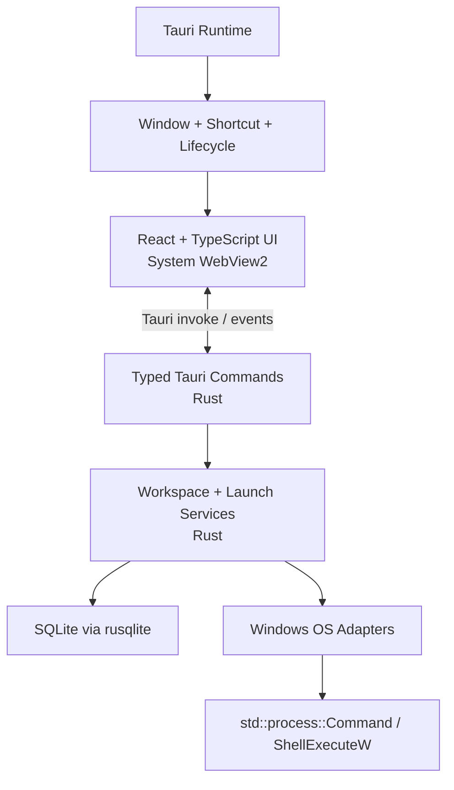

# DeskPilot

> **Lightweight local-first Windows workspace launcher that restores your working context in one action.**

DeskPilot is a personal productivity utility built specifically for Windows 11 and 10. A workspace is a saved collection of applications, folders, website links, terminal locations, notes, and checklist items. Instead of repeatedly finding and launching tools whenever you switch between activities (e.g., Development, Study, Finance, Gaming), DeskPilot restores your entire environment with a single click or keyboard shortcut.

---

## ✨ Features

- **Workspace Management:**
  - Create, edit, duplicate, search, favorite, and delete workspaces.
  - Custom Fluent-inspired icons and accessible color themes.
  - Safe deletion: cascades through launch items, notes, and tasks while preserving unlinked launch run history snapshots.

- **Multi-Resource Launch Engine:**
  - **Applications:** Direct execution of `.exe` and Windows `.lnk` shortcuts using explicit parameter arrays (no shell interpreters).
  - **Folders:** Opens directories directly in Windows File Explorer via native `ShellExecuteW`.
  - **Websites:** Strictly validated HTTP/HTTPS URLs opened in your default browser with a configurable stagger delay (default 250ms).
  - **Terminals:** Opens Windows Terminal (`wt.exe`) or PowerShell focused directly on your project directory with safe literal path quoting.
  - **Fault Isolation:** If an individual item fails (e.g. file moved or deleted), the remaining items continue to launch.
  - **Missing Resource Detection:** Warns if a configured executable, directory, or folder has been moved or deleted.

- **Workspace Context:**
  - **Notes:** Autosaving Markdown/plain-text scratchpad per workspace with debounced background saving.
  - **Checklists:** Interactive task lists with completion status and progress tracking.

- **Quick Switcher & Global Shortcut:**
  - Global hotkey: `Ctrl + Alt + Space` summons the switcher from anywhere while DeskPilot is running.
  - In-app hotkey: `Ctrl + K` opens the quick switcher directly from the window.
  - Keyboard-driven navigation: Arrow keys to browse, Enter to launch, Escape to dismiss.

- **Activity & Audit History:**
  - Reverse-chronological launch audit trail.
  - Per-item timings, exit statuses, and human-readable error messages.
  - Automatic startup pruning (retains last 90 days or 500 runs).

---

## 🛠 Technology Stack

| Layer | Technology | Responsibility |
|---|---|---|
| Desktop runtime | **Tauri 2** (`2.12.7`) | Windows windowing, lifecycle, IPC commands, and global shortcuts |
| Native backend | **Rust** (`2024` edition) | Launch orchestration, SQLite queries, Windows OS adapters |
| Web frontend | **React 18** + **TypeScript** + **Vite** | Fluent-inspired UI, form validation, and reactive event listeners |
| Rendering runtime | **System WebView2** | Uses preinstalled Edge WebView2 runtime (no bundled Chromium or Electron) |
| UI styling | **CSS Modules** | Fast, scoped styles with Windows 11 Fluent design tokens |
| Local database | **SQLite** via `rusqlite` (`0.43`) | Embedded persistent local storage with WAL and foreign-key integrity |
| Icons | **Lucide Icons** | Lightweight, tree-shaken SVG icons |

---

## 🏗 Architecture



---

## 🔒 Security & Privacy Model

- **100% Local-First:** No accounts, no cloud sync, and zero telemetry. Data never leaves your PC.
- **Least-Privilege Capabilities:** The frontend WebView2 runtime is locked down via a strict Content Security Policy (`default-src 'self'`) and cannot access arbitrary files or shell commands.
- **Safe Process Spawning:** Applications are invoked using explicit executable paths and argument arrays from Rust (`std::process::Command::new(path).args(...)`). Shell interpreters (`cmd.exe` or PowerShell) are never invoked for normal application launches.
- **Terminal Item Safety:** Terminal launch items only set the initial working directory (`-d <path>` or `Set-Location -LiteralPath '<path>'`). DeskPilot does not execute arbitrary scripts from workspace definitions.
- **URL Sanitization:** URLs are parsed by the `url` crate; schemes other than `http` and `https` (such as `file:`, `javascript:`, or `data:`) are rejected. URLs with embedded credentials or lengths exceeding 2,000 characters are blocked.

---

## 💾 Data Storage Location

All configuration, workspaces, and audit history are stored in your Windows user profile:

- **Database:** `%LOCALAPPDATA%\DeskPilot\deskpilot.sqlite`
- **Logs:** `%LOCALAPPDATA%\DeskPilot\logs\`
- **Backups:** `%LOCALAPPDATA%\DeskPilot\backups\`

---

## 🚀 Development Setup & Build Instructions

### Prerequisites
- Windows 10 (version 22H2+) or Windows 11 x64
- [Rust](https://rustup.rs/) (1.90+ with MSVC toolchain)
- [Node.js](https://nodejs.org/) (20+ or 24+)
- Microsoft Edge WebView2 runtime (preinstalled on Windows 10/11)

### Commands

1. **Install dependencies:**
   ```bash
   npm install
   ```

2. **Run in development mode:**
   ```bash
   npm run tauri dev
   ```

3. **Run tests:**
   ```bash
   # Frontend build & type check
   npm run build

   # Rust unit and integration test suite
   cd src-tauri
   cargo test
   ```

4. **Build Windows Installer (NSIS):**
   ```bash
   npm run tauri build
   ```

---

## ⚡ Performance & Resource Profile

- **Cold Launch:** Loads the native UI in < 2 seconds using the system-installed WebView2 runtime.
- **Idle Resource Footprint:** Minimal memory footprint through native Rust host; no persistent background timers or database polling loops.
- **Event-Driven Progress:** Workspace launches emit events on item completion (`launch-progress`), eliminating UI polling.

---

## 📋 Acceptance Verification Checklist

- [x] DeskPilot boots as a native Windows desktop application.
- [x] Workspace CRUD: Create, Read, Update, Delete (with cascade), Duplicate, and Favorites persist.
- [x] All 4 launch item types (Application, Folder, Website, Terminal) are supported.
- [x] Sequential launch engine with phase ordering (local items first, staggered URLs second).
- [x] Fault isolation: broken items fail safely without cancelling remaining items.
- [x] Missing resource detection warns if paths are moved or deleted.
- [x] Debounced autosaving workspace notes and interactive checklist with progress tracking.
- [x] Quick Switcher opens globally (`Ctrl + Alt + Space`) and in-app (`Ctrl + K`).
- [x] Activity history stores run snapshots and per-item timing/error codes.
- [x] All 10 backend tests pass; frontend compiles with zero errors.
